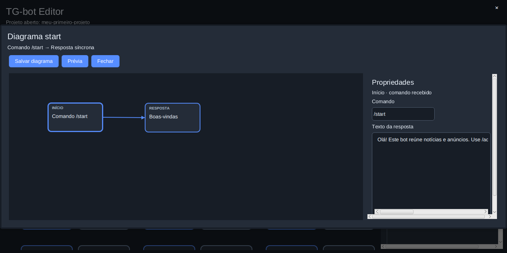

# TG-bot Editor


Editor desktop para criar, testar e executar fluxos de bots do Telegram. Cada projeto guarda seus gatilhos em `bot.json` e suas regras Java em `scripts/`. O editor oferece um painel visual; o bot gerado também pode rodar sozinho no Linux ou no Termux, sem JavaFX.

## Começar

O editor requer JDK 25, com `javac`, e um ambiente gráfico. Na raiz deste repositório:

```sh
./gradlew test
./gradlew run
```

Por padrão, o Gradle inclui os checkouts de `megalodonte-components` e `megalodonte-theme` do workspace Megalodonte. Em outra estrutura de pastas, use `-PuseLocalSources=false` se as dependências Megalodonte já estiverem disponíveis no Maven Local ou em um repositório configurado:

```sh
./gradlew -PuseLocalSources=false run
```

## Criar e executar um projeto

1. Clique em **Novo projeto**, informe o nome e a pasta de destino. O editor cria `bot.json`, `diagrams.json`, `scripts/`, o código do runner, o Gradle Wrapper e `.env.example`.
2. Abra um card de diagrama e edite seus componentes em **Propriedades**. Use **+ Script** quando a ação precisar de uma classe própria. A criação visual de novos diagramas ainda está em desenvolvimento.
3. Clique em **Aplicar** para atualizar o fluxo e em **Salvar projeto** para gravá-lo. **Executar teste** roda a ação selecionada localmente com a entrada de exemplo, sem enviar mensagem ao Telegram.
4. Preencha `TG_BOT_TOKEN` em **Variáveis de ambiente do projeto** ou no `.env` do projeto. Clique em **Executar** para iniciar o bot; o mesmo botão passa a **Parar** enquanto ele estiver ativo. A saída fica em `data/bot-runner.log` na pasta do projeto.

**Abrir projeto** seleciona um `bot.json` existente. **Abrir pasta do projeto** mostra os arquivos para edição externa. **Exportar comandos** cria `comandos.txt` a partir dos fluxos `COMMAND`; ao iniciar, o runner também publica esses comandos no menu `/` do Telegram. Reinicie o bot depois de alterar fluxos ou scripts. Use apenas uma instância por token, pois duas instâncias disputam o long polling.

Um projeto criado pelo editor tem esta estrutura:

```text
meu-bot/
├── bot.json                 # gatilhos, padrões e ações
├── diagrams.json            # diagramas visuais; os habilitados têm prioridade sobre bot.json
├── scripts/                 # classes Java do projeto
├── runtime/                 # runner e API genérica do bot
├── gradlew                  # build independente do editor
├── .env.example             # variáveis disponíveis, sem segredos
├── .env                     # configuração local, ignorada pelo Git
└── data/                    # estado e logs locais, ignorados pelo Git
```

A tela inicial mostra os diagramas do projeto em cards. Clique em **Abrir diagrama** para editar o fluxo visual; fluxos ainda não migrados continuam no `bot.json` e são executados pelo runner. Ao selecionar um componente no canvas, o painel mostra seu nome e suas propriedades: **Tipo de evento** e **Padrão** para o início ou **Texto da resposta** para a resposta síncrona. No componente **Timer**, informe o intervalo em minutos; o fluxo inicia com o bot e é repetido após cada intervalo. No diagrama `start`, selecione cada um dos dois componentes para editar esses campos e depois clique em **Salvar diagrama**. Ao selecionar um nó **Java**, edite sua **Action** no próprio diagrama. Para passar seu retorno à resposta síncrona, use `{{output}}` no campo de texto; isolado, ele também encaminha mensagens ou listas sem convertê-las em texto. A action pode chamar classes existentes em `scripts/`. Ao salvar, um diagrama habilitado tem prioridade sobre o fluxo legado do mesmo comando. O formato e as decisões em aberto estão em [proposta do editor de diagramas](docs/proposta-editor-diagramas.md).

O [contexto e andamento](docs/CONTEXT.md), as [decisões](docs/DECISIONS.md) e as [próximas etapas](docs/TODO.md) acompanham a evolução do projeto.

Na tela de um diagrama, arraste um item da paleta **Componentes** para posicioná-lo no canvas e clique em **Salvar diagrama** para guardá-lo. Cada diagrama admite um início. Os novos componentes ficam sem conexão; a criação de conexões e a configuração e execução dos novos tipos ainda estão em desenvolvimento.

Para inspecionar um Splitter existente, selecione-o e clique em **Criar ou abrir subfluxo**; o subfluxo abre em um popup sobre o diagrama atual. Use **Salvar diagrama** para gravar as alterações e **Fechar** para retornar ao diagrama que o contém. O caminho `{{output}}` percorre a lista devolvida pela etapa anterior; no subfluxo, a primeira action Java recebe cada item em `input` e sua posição (começando em zero) em `index`; nas actions seguintes, `input` recebe o resultado da etapa anterior. O Splitter devolve as respostas em ordem; a opção `concat` reúne resultados textuais e está configurada no arquivo do diagrama. Conexões e opções de agregação ainda não são editáveis visualmente.

Os editores Java destacam os tipos comuns, a API do bot e as classes encontradas pelos nomes dos arquivos `.java` em `scripts/`. Ao criar um script pelo editor ou abrir novamente o diagrama, a lista é atualizada para o projeto atual.



Para validar ou executar o projeto sem abrir o editor, use JDK 21 ou superior dentro da pasta criada:

```sh
./gradlew clean build
java -jar build/libs/*.jar --check bot.json
java -jar build/libs/*.jar bot.json
```

`--check` compila e valida os fluxos sem conectar ao Telegram nem exigir token. Antes da execução real, copie `.env.example` para `.env` e configure o token. O README gerado no projeto explica o uso no Termux.

## Gatilhos e botões

O campo **Padrão** depende do gatilho:

| Gatilho | Exemplo de padrão | Quando executa |
| --- | --- | --- |
| `COMMAND` | `/menu` | Comando recebido, inclusive com argumentos ou `@nome_do_bot`. |
| `TEXT` | `pedido:*` | Texto que começa com `pedido:`. |
| `CALLBACK` | `menu:detalhes` | Clique em botão que envia esse dado. |
| `PHOTO` ou `DOCUMENT` | `*` | Qualquer mensagem do tipo correspondente. |
| `INTERVAL` | `10` | A cada 10 minutos. |
| `DAILY` | `09:00,18:30` | Nos horários indicados. |

Em `TEXT`, `CALLBACK`, `PHOTO` e `DOCUMENT`, `*` aceita qualquer valor e um asterisco final cria um prefixo, como `menu:*`. Um padrão exato tem prioridade sobre prefixos; `*` serve como fallback. `COMMAND` não usa asterisco.

Uma ação pode devolver texto simples ou um `BotReply`. Este exemplo mostra como um botão aciona outro fluxo:

```java
return BotReply.text("Escolha uma opção:").withButtons(java.util.List.of(
    BotButton.callback("Detalhes", "menu:detalhes"),
    BotButton.link("Site", "https://example.com")
));
```

O botão **Detalhes** envia `menu:detalhes` ao bot. Crie um fluxo `CALLBACK` com esse padrão e, em seu script, retorne uma resposta:

```java
return "Você clicou em Detalhes.";
```

Nesse fluxo, `context.text()` contém o dado recebido. Use `menu:*` para tratar vários botões da mesma família e `context.commands().runAction(id, context)` quando um fluxo precisar executar outra ação do projeto. O botão **Site** apenas abre a URL. Cada botão aparece em sua própria linha.

As respostas, permissões, assinaturas de canais e regras de anúncios pertencem aos scripts do **projeto do bot**. O editor fornece os gatilhos, a persistência e o transporte Telegram; ele não define os comandos particulares de um bot.

## Configuração e dados

O `.env` é local e ignorado pelo Git. Variáveis do processo prevalecem sobre ele. O token do bot é `TG_BOT_TOKEN`; `TG_BOT_ADMIN_ID` e `YOUTUBE_API_KEY` ficam disponíveis para scripts que precisem deles. O banco JSON do runner fica, por padrão, em `data/bot-database.json` dentro do projeto. Defina `TG_BOT_DATABASE_FILE` para usar outro arquivo `.json`; um caminho relativo é resolvido a partir da pasta do projeto.

O editor guarda a lista de projetos recentes na configuração do usuário, fora dos projetos. Ao abrir, restaura o projeto principal configurado, o mais recente ou cria um projeto inicial. Se precisar indicar explicitamente o projeto principal, use a propriedade de sistema `tg.bot.editor.canonicalBot` com o caminho de seu `bot.json`.

## Empacotar

O empacotamento usa Python 3 e a biblioteca separada `megalodonte-packaging`, instalada no ambiente ou indicada por `MEGALODONTE_PACKAGING_HOME`:

```sh
python3 scripts/package.py build appimage
```

O [workflow de empacotamento](.github/workflows/package.yml) produz pacotes para Linux e Windows em execução manual ou tag `v*`.

Exemplo de action Java dentro do subfluxo de um Splitter:

```java
return "Item " + (index + 1) + ": " + input;
```

Uma Resposta síncrona seguinte pode enviar esse resultado com `{{output}}`.
